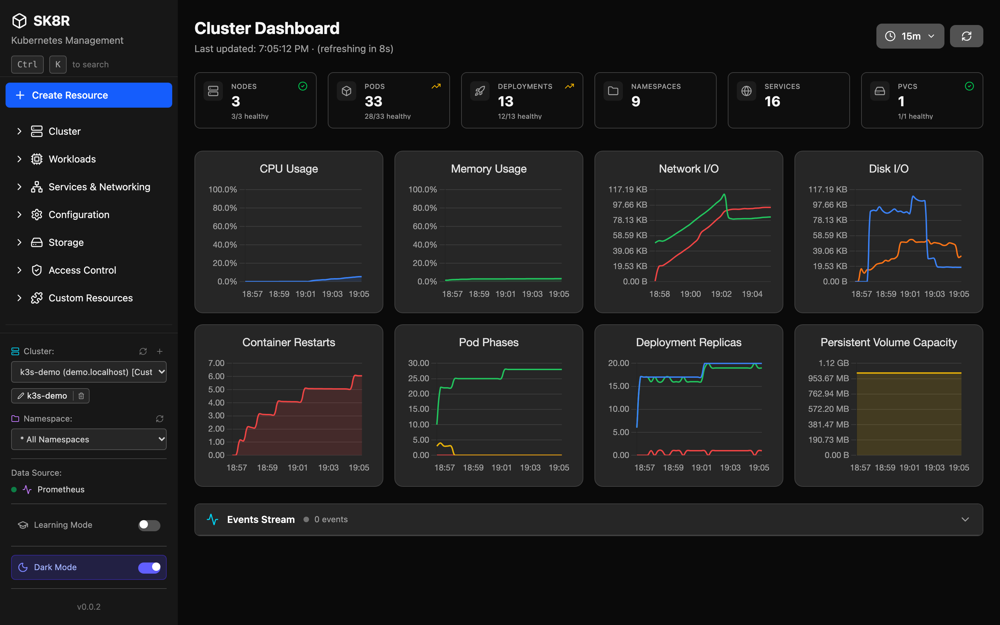
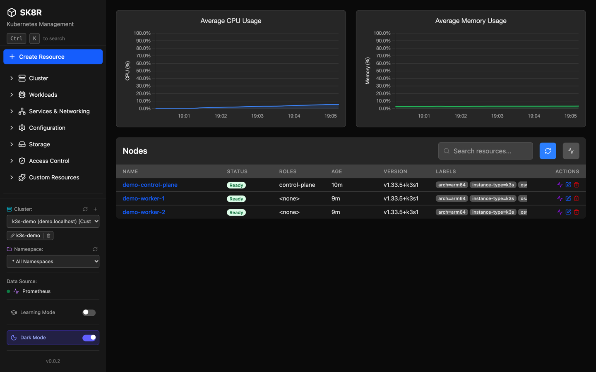
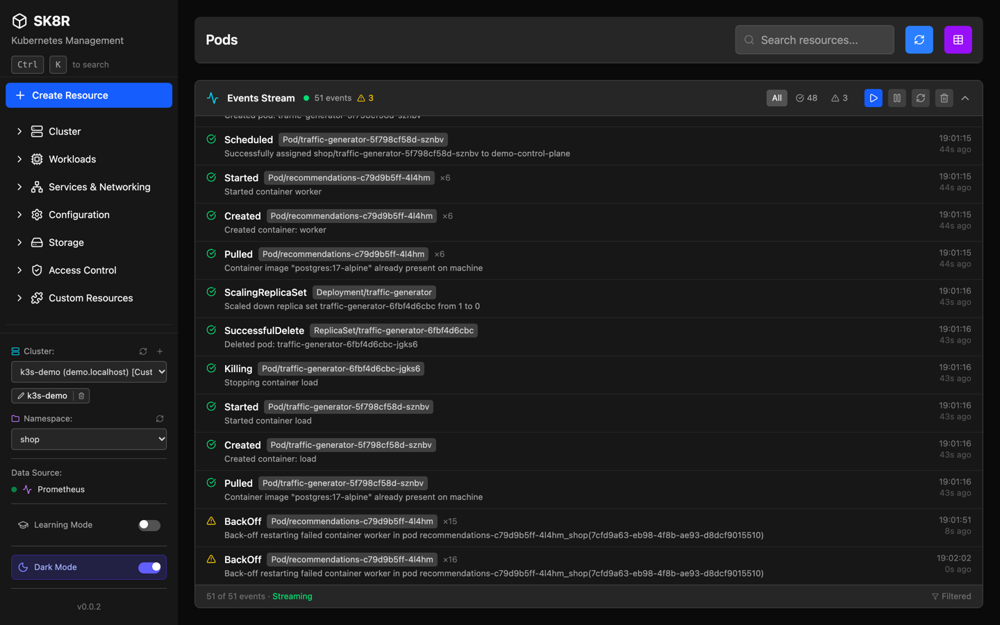
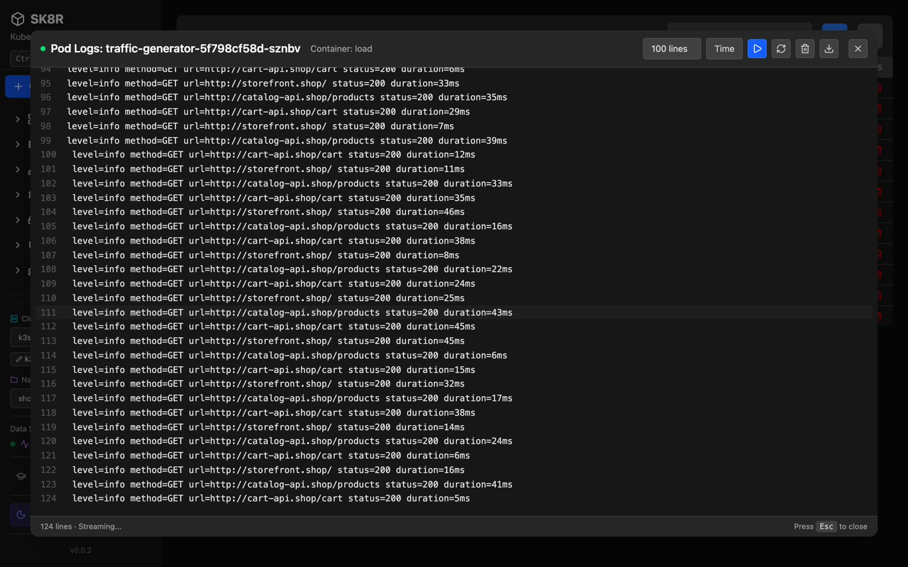
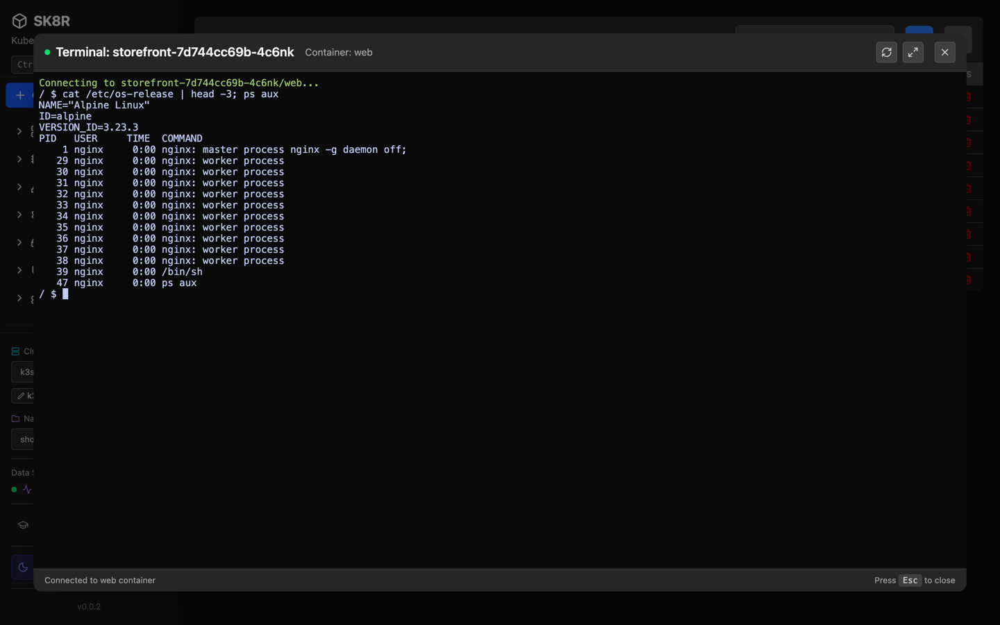
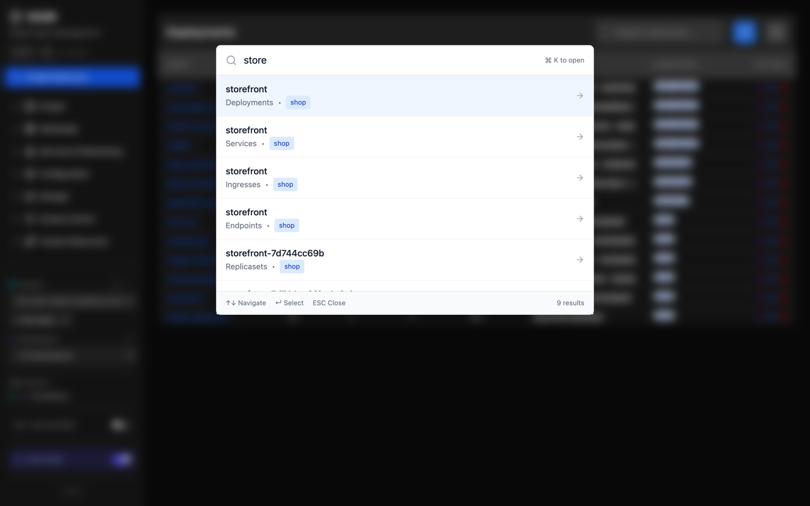
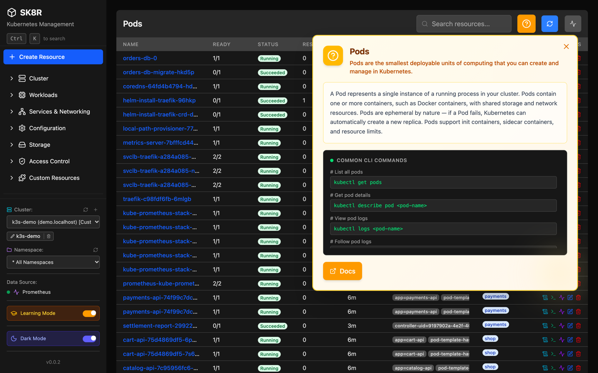
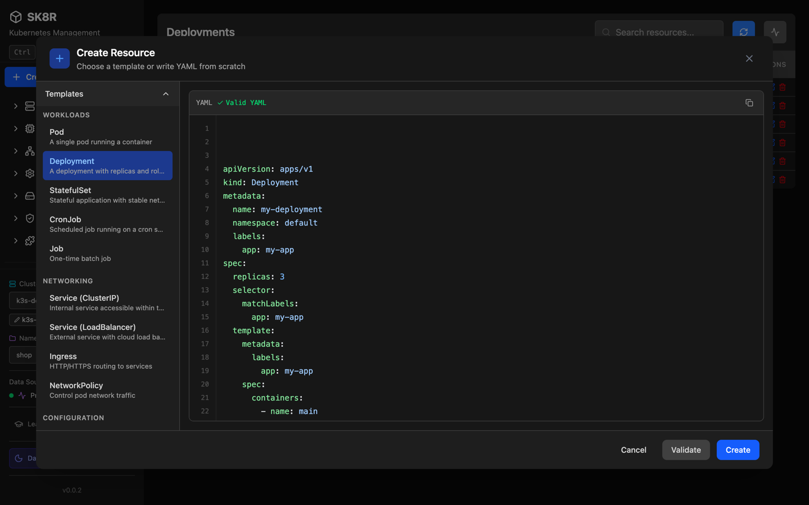
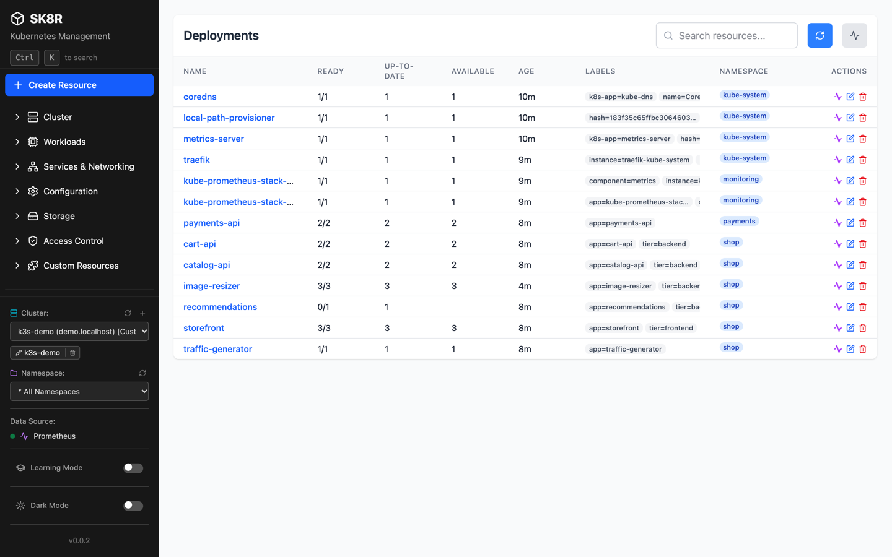

# sk8r

**A Kubernetes dashboard you'll actually want to keep open.**

sk8r covers what you'd expect from the classic Kubernetes Dashboard: browse, edit and delete resources, read logs, open a shell in a pod. It also gives you a Prometheus-powered cluster overview, a live events stream, <kbd>Ctrl</kbd>+<kbd>K</kbd> search across every resource, multi-cluster switching, and a Learning Mode that explains each resource and shows the `kubectl` commands behind it.

It ships as one container and installs with one `kubectl apply`.



## What you get

- **Cluster overview at a glance.** Health cards for nodes, pods, deployments, namespaces, services and PVCs, plus live charts for CPU, memory, network and disk I/O, container restarts, pod phases, replica health and volume capacity. Pick any window from 5 minutes to 24 hours, or set a custom one.
- **One click from a row to what you need.** Every pod row opens its logs, a shell, or its events. Edit and delete sit right next to them. The node list shows average CPU and memory charts above the table.
- **Live events stream.** Cluster events stream in as they happen, with repeat counts and warnings flagged, so a crash-looping pod stands out right away.
- **Search everything.** Press <kbd>Ctrl</kbd>+<kbd>K</kbd> (<kbd>⌘</kbd>+<kbd>K</kbd> on macOS) and jump to any deployment, service, ingress, pod or config by name, across all namespaces.
- **Logs and shell in the browser.** Stream pod logs with timestamps, pause, and download. Open a full xterm.js terminal inside any container.
- **Create and edit as YAML.** Start from templates for common resources (Deployments, StatefulSets, CronJobs, Services, Ingresses, NetworkPolicies, ConfigMaps, Secrets, PVCs and more), with YAML checked as you type. Edit live resources the same way.
- **Learning Mode.** Every resource type comes with a plain-language explanation, common `kubectl` commands, and a link to the official docs. Includes a step-by-step guide on moving from traditional hosting to Kubernetes. Useful for onboarding a team, and for remembering that one flag.
- **Multiple clusters.** Add clusters by API URL and token, then switch between them from the sidebar. Credentials are stored in your browser, not on the server.
- **Custom resources.** Built-in views for Traefik (IngressRoutes, Middlewares, TLS options) and cert-manager (Certificates, Issuers, ClusterIssuers).
- **Dark and light themes.**

## Screenshots

<table>
  <tr>
    <td width="50%"><br><sub><b>Nodes</b>: average CPU and memory above the list</sub></td>
    <td width="50%"><br><sub><b>Live events</b>: warnings and repeat counts as they happen</sub></td>
  </tr>
  <tr>
    <td><br><sub><b>Pod logs</b>: streaming, timestamps, download</sub></td>
    <td><br><sub><b>Pod terminal</b>: a real shell in the browser</sub></td>
  </tr>
  <tr>
    <td><br><sub><b>Global search</b>: <kbd>Ctrl</kbd>+<kbd>K</kbd> to find any resource</sub></td>
    <td><br><sub><b>Learning Mode</b>: explanations and kubectl commands</sub></td>
  </tr>
  <tr>
    <td><br><sub><b>Create from templates</b>: YAML checked as you type</sub></td>
    <td><br><sub><b>Light theme</b>, if that's your thing</sub></td>
  </tr>
</table>

## Quick Start

Deploy sk8r to your Kubernetes cluster with a single command:

```sh
kubectl apply -f https://raw.githubusercontent.com/mvklingeren/sk8r/main/k8s/rbac.yaml \
              -f https://raw.githubusercontent.com/mvklingeren/sk8r/main/k8s/nodes-rbac.yaml \
              -f https://raw.githubusercontent.com/mvklingeren/sk8r/main/k8s/deployment.yaml \
              -f https://raw.githubusercontent.com/mvklingeren/sk8r/main/k8s/service.yaml
```

Or clone the repository and apply all manifests:

```sh
git clone https://github.com/mvklingeren/sk8r.git
cd sk8r
kubectl apply -f k8s/
```

## Prerequisites

- A running Kubernetes cluster
- `kubectl` installed and configured to connect to your cluster
- **(Optional) Prometheus:** For metrics visualization, the dashboard expects Prometheus to be available at `http://kube-prometheus-stack-prometheus.monitoring:9090`. We recommend installing the [kube-prometheus-stack](https://github.com/prometheus-community/helm-charts/tree/main/charts/kube-prometheus-stack) Helm chart.

## Accessing the Dashboard

The application is exposed via a `LoadBalancer` service. To find the external IP address:

```sh
kubectl get service sk8r-app-service -o jsonpath='{.status.loadBalancer.ingress[0].ip}'
```

Open your browser and navigate to the IP address returned by the command.

## Configuration

### Custom Namespace

By default, sk8r is deployed to the `default` namespace. To deploy to a different namespace:

```sh
kubectl create namespace sk8r
kubectl apply -f k8s/ -n sk8r
```

Note: You'll need to update the RBAC manifests to reference the correct namespace for the ServiceAccount.

### Prometheus URL

If your Prometheus instance is running at a different address, update the `PROMETHEUS_URL` environment variable in the deployment:

```yaml
env:
  - name: PROMETHEUS_URL
    value: 'http://your-prometheus-service:9090'
```

### Restricting cluster API servers

The backend connects to whichever API server URL the browser sends. If sk8r is reachable by people you don't fully trust, limit it to known clusters (comma-separated, exact URLs):

```yaml
env:
  - name: K8S_ALLOWED_SERVERS
    value: 'https://10.0.0.1:6443,https://k8s.example.com:6443'
```

### Alternative Service Types

The default service type is `LoadBalancer`. For other environments:

**NodePort:**

```yaml
spec:
  type: NodePort
  ports:
    - port: 80
      targetPort: 3000
      nodePort: 30080 # Optional: specify a port
```

**ClusterIP with Ingress:**

```yaml
spec:
  type: ClusterIP
```

Then create an Ingress resource pointing to the `sk8r-app-service`.

---

## Contributing

### Development

To run the application locally for development:

1.  **Install dependencies:**

    ```sh
    npm install
    ```

2.  **Start the development server:**
    ```sh
    npm run dev
    ```
    The application will be available at `http://localhost:5173`.

### Building from Source

If you want to build and push your own Docker image:

1.  **Build and push the Docker image:**

    ```sh
    docker buildx build --platform linux/amd64,linux/arm64 -t your-registry/sk8r-app:latest --push .
    ```

2.  **Update the deployment to use your image:**

    ```sh
    kubectl set image deployment/sk8r-app sk8r-app=your-registry/sk8r-app:latest
    ```

    Or edit `k8s/deployment.yaml` to reference your image before applying.
